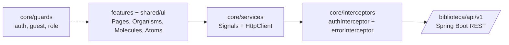

# Arquitectura y Comunicación — Biblioteca farsheen (Frontend)

Aplicación Angular 22 **Zoneless + Signals** bajo Atomic Design (`core / shared/ui / features`) conectada por HTTP REST + JWT al backend Spring Boot mediante proxy de desarrollo (`proxy.conf.json`).

## 1. Capas y flujo de datos

## 2. Flujos principales
- **Login → Token → Interceptor → API:** `LoginPage` envía credenciales vía `AuthService.login()`, recibe `{token, rol, correo, nombreCompleto}` y guarda la sesión en `localStorage` validando estructura JWT y `exp`. En cada petición hacia `environment.apiUrl`, `authInterceptor` inyecta `Authorization: Bearer <token>`. Ante `401` fuera de `/auth/**`, `errorInterceptor` cierra sesión una sola vez y redirige a `/login?returnUrl=...` (saneado).
- **Reservar libro:** Desde `/catalog` o `/catalog/:id`, si no hay sesión se redirige a `/login?returnUrl=...`. Con sesión activa, el usuario elige fecha de inicio/entrega, consulta `GET /libros/{id}/disponibilidad` y confirma `POST /reservas`; al responder `201`, el sistema abre el drawer lateral de **Mis reservas** y refresca el catálogo.

## 3. Módulos
- **`core/`:** Contiene modelos TypeScript alineados con los DTOs REST, servicios singleton con estado en signals (`AuthService`, `CatalogoService`, `ReservasService`, `AdminLibrosService`, `AdminReservasService`, `AdminUsuariosService`, `ThemeService`, `UiStateService`, `NotificationService`), guards funcionales (`authGuard`, `guestGuard`, `roleGuard`), interceptores funcionales y utilidades (`busqueda-difusa.ts`, `return-url.util.ts`, `portada.ts`).
- **`shared/ui/`:** Componentes reutilizables en cuatro niveles: átomos (`badge`, `button`, `icon`, `input`, `theme-toggle`), moléculas (`book-card`, `brand`, `search-bar`, `stat-chip`, `toast`), organismos (`header`, `site-footer`, `book-grid`, `reservas-drawer`, `reserva-dialog`) y plantilla (`main-layout` con sub-barra contextual).
- **`features/`:** Páginas con carga diferida (`loadComponent`): `home` (`/`), `catalog` (`/catalog`, `/catalog/:id` con paginación de 12 y disponibilidad), `reservas` (`/reservas` con búsqueda por ID y cancelación > 24 h), `auth` (`/login`), `admin` (`/admin/{libros,reservas,usuarios}` solo rol `ADMIN`) y `not-found` (`**`).

## 4. Seguridad en cliente y tema
- CSP estricta en `index.html`, cero `innerHTML` o `bypassSecurityTrust*`, saneado estricto de `returnUrl` anti-Open Redirect, validación de `exp` y sincronización de logout entre pestañas mediante evento `storage`.
- Paleta del PDF en `src/styles.scss` con tema tri-estado (neutro/oscuro/claro) sin FOUC (`public/theme-init.js`).
